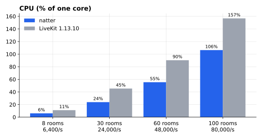
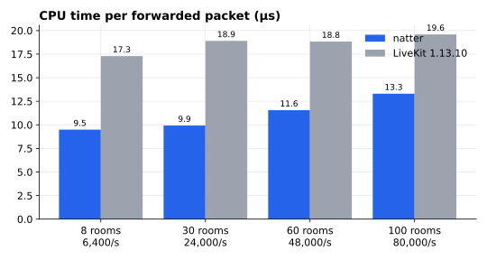
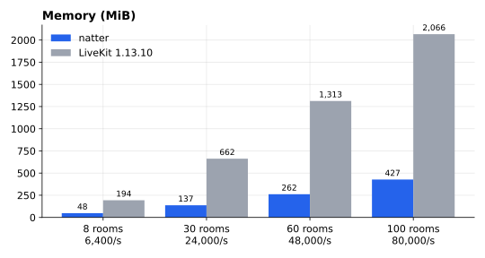
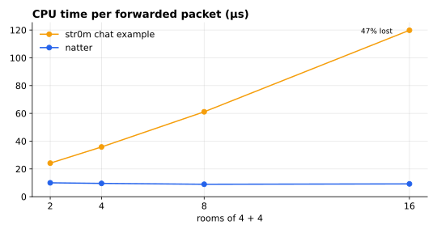

# Benchmarks

How natter compares with LiveKit, the server whose protocol it speaks, and
with other open-source SFUs. Every server here is driven by the same
client, [`natter-load`](../../crates/load), so differences are the servers'.

**Summary, audio rooms of 4 publishers + 4 subscribers:**

- natter uses **38–68% less CPU** than LiveKit 1.13.10 for the same
  traffic, and **a quarter to a third of the memory**.
- natter lost no packet at any load tested, up to 80,000 forwarded
  packets a second, with latency p99 under 1 ms. LiveKit lost none up to
  60 rooms (p99 0.3–1.7 ms); at 100 rooms, using 163% of a core, it lost
  0.06–0.15% with p99 above a second.
- Under 5% packet loss, natter's resends recover more of it (0.002% left
  vs 0.26%) and sooner.
- Setting clients up is quicker on natter: p99 88–91 ms against
  126–137 ms at 8 rooms, 170–193 ms against 317–383 ms at 100; at 60
  rooms both are about 0.2 s.
- LiveKit still has egress, ingress and SIP, which natter doesn't (see
  [features](#features)).

**Video, single-layer VP8 at 1.5 Mbit/s, under packet loss:** natter
repairs more of it, sooner. At 5% loss each way no frame was lost or
undecodable through natter (p99 88 ms), against 0.1% lost and 0.8–1.7%
undecodable through LiveKit (p99 260 ms). At 10% each way: 1–2% of frames
undecodable against 11%. At 20% both break down. See
[video under loss](#video-under-packet-loss).

## natter vs LiveKit







| Rooms | Forwarded/s | natter CPU | LiveKit CPU | natter memory | LiveKit memory |
|---|---|---|---|---|---|
| 8 | 6,400 | 5.0% (7.8 µs/packet) | 15.6% (24.3 µs) | 61 MiB | 194 MiB |
| 30 | 24,000 | 19.3% (8.1 µs) | 52.7% (22.0 µs) | 171 MiB | 650 MiB |
| 60 | 48,000 | 47.0% (9.8 µs) | 103.7% (21.6 µs) | 318 MiB | 1.3 GiB |
| 100 | 80,000 | 100% (12.6 µs) | 163% (20.4 µs) | 525 MiB | 2.0 GiB |

CPU is a share of one core, for the whole server process (natter) or
container (LiveKit). Each figure is the mean of two runs, which agreed
within 5%. LiveKit cost 4–40% more here than in the earlier
runs (2026-10-17) with the same image; sessions on a busy desktop drift,
which is why the servers alternate within one. natter's memory is higher
than then because engines now fill to 120 participants, so more of them
run, each with its own 4 MiB socket buffers.

| Rooms | natter latency p50 / p99 | LiveKit latency p50 / p99 | natter setup p50 / p99 | LiveKit setup p50 / p99 |
|---|---|---|---|---|
| 8 | 0.07 / 0.18 ms | 0.10–0.12 / 0.30–0.36 ms | 38–41 / 88–91 ms | 76–83 / 126–137 ms |
| 30 | 0.12–0.13 / 0.33–0.35 ms | 0.18–0.19 / 0.65–0.70 ms | 77–86 / 156–161 ms | 93–94 / 167–169 ms |
| 60 | 0.18 / 0.52–0.53 ms | 0.29–0.30 / 1.66–1.69 ms | 89–98 / 193–201 ms | 106–107 / 184–201 ms |
| 100 | 0.21–0.22 / 0.98–0.99 ms | 199–238 / 1,177–1,295 ms | 107–117 / 170–193 ms | 117–122 / 317–383 ms |

Latency is one way, from the publisher's send to the subscriber's
receipt; both are in one process on loopback, so it is the server's own
delay. Setup is from starting to join until the client's last peer
connection is up, with 16 clients joining at a time. Ranges are the two
runs.

**Setup.** natter's setup p99 was 1.2–1.4 s at first. Fixed since (the
figures in this part are from 2026-10-17 to 2026-10-21):

- As answerer it now starts the DTLS handshake itself, as browsers and
  LiveKit do, instead of waiting for a client ClientHello it might drop
  before its own ICE check had passed; and an ICE nomination no longer
  waits out a cached retransmit timer (both in
  [`vendor/README.md`](../../vendor/README.md)).
- Joins are the engine's busiest moments: up to 250 participants share
  one engine, so a burst of joins queues DTLS handshakes on one thread.
  Its socket buffer is now 4 MiB so the burst isn't dropped; P-256
  signatures use p256 0.14 (55 µs to sign, 150 µs to verify, against
  131 and 222 µs); and subscriber renegotiation is debounced as LiveKit
  does (10 ms first, 150 ms after), halving the SDP sent and parsed.

What is left is handshake crypto: with `NATTER_DTLS_CRYPTO=aws-lc` (C and
assembly, off by default) setup at 30 rooms is p50 0.20 s, p99
0.31–0.35 s, the same as LiveKit's, against 0.27–0.29 s and 0.38–0.41 s
in pure Rust (interleaved). Spreading rooms over all engines
(`NATTER_SHARD_FILL=16`) also removes it, at some CPU cost per packet.

Since engines are pinned to a CPU each, a quiet engine costs less, and the
default fill is 120 instead of 250: a burst of joins then queues on twice
as many engines. Audio rooms (4+4) with `natter-load`, two interleaved
rounds, setup p50/p99 in ms and CPU:

| rooms | fill 250 | fill 160 | fill 120 |
|---|---|---|---|
| 30 | 85/186, 23% | 62/163, 24% | 59/147, 24% |
| 60 | 124/226–229, 54% | 89/175, 54% | 72–76/155–167, 53% |
| 100 | 162–183/286–308, 100% | 113/186, 103% | 101–120/204–221, 106–107% |

Stoat's LiveKit (v1.9.14) on the same machine: 91–94/143–156 ms at 30
rooms (47%), 99–101/175–178 ms at 60 (95%), 107–119/270–342 ms at 100
(164–172%).

**Cores.** natter runs one media engine per core and gives each room
wholly to one engine. Rooms fill one engine (120 participants) before the
next is used, so 8 rooms here ran on one core and 100 rooms on seven. One engine alone can't carry 100 rooms: it lost 26% of packets
(`r100-one` in the data). LiveKit spreads work over every core.

### Packet loss

5% of RTP and RTCP dropped at the client, 8 rooms. Both servers resend
lost audio when asked (NACK); what is left is what resends didn't recover
in time.

| Dropped | natter: still lost | natter p99 | LiveKit: still lost | LiveKit p99 |
|---|---|---|---|---|
| Server → client | 0.002% | 51 ms | 0.26% | 220 ms |
| Client → server | 0% | 50 ms | 0% | 60 ms |

## Video under packet loss

4 rooms of 2 publishers + 4 subscribers. Each publisher sends one VP8
camera track, 1.5 Mbit/s at 30 fps (6 KiB frames, about six packets;
keyframes four times that, sent first and whenever asked for), no
simulcast. RTP and RTCP are dropped at random at the client, after
everyone is connected. Two runs per row; ranges are both.

| Dropped each way | natter: frames lost | undecodable | p50 / p99 | LiveKit: frames lost | undecodable | p50 / p99 |
|---|---|---|---|---|---|---|
| 0% | 0 | 0 | 0.3 / 0.5–0.6 ms | 0 | 0 | 0.2–0.3 / 0.5–0.7 ms |
| 2% | 0 | 0 | 0.3 / 62–66 ms | 0 | 0 | 0.4–0.5 / 147–150 ms |
| 5% | 0 | 0 | 5–7 / 87–88 ms | 0.09–0.11% | 0.8–1.7% | 68–71 / 258–267 ms |
| 10% | 0.11–0.15% | 1.1–1.9% | 31–33 / 234–262 ms | 1.7% | 11% | 121–125 / 500 ms |
| 20% | 41–42% | 51–52% | 434 / 501 ms | 48–50% | 43–44% | 466 / 501 ms |
| 5% server → client only | 0 | 0 | 0.3 / 65–66 ms | 0.03–0.13% | 0.4–1.4% | 65–66 / 244–264 ms |
| 5% client → server only | 0 | 0 | 0.3–0.4 / 65–66 ms | 0 | 0 | 0.3 / 68 ms |

- **Frames lost:** never delivered whole. **Undecodable:** delivered, but
  after a frame was lost, before the next keyframe; a decoder couldn't
  show them. Latency is per frame, from the publisher's send to the
  subscriber having all of it, so a frame waiting on a resend (and every
  frame queued behind it) counts the wait. 500 ms is the client's limit
  (below).
- Upstream loss is recovered equally: both servers NACK the publisher and
  it resends. The difference is downstream, in how the server answers
  subscribers' NACKs. natter resends from its 500-packet buffer on every
  NACK. LiveKit resends a packet at most three times, at least
  min(100 ms, 2 × RTT) apart, taking 70 ms for an RTT it reads as zero (as
  on loopback), so when a resend is itself dropped the next one waits; and
  once a subscriber sends a PLI it stops resending to it until the next
  keyframe (`sequencer.go`, `downtrack.go` in 1.13.10). Its frames are delivered later, and more are given up on.
- At 20% each way a frame of six packets loses at least one on each hop
  about 74% of the time, before resends; neither server keeps the stream
  watchable.
- Server CPU at this load: natter 5.1–6.5% of a core, LiveKit 7.8–12%.

**The client.** `natter-load --video` is str0m in frame mode, set up to
behave like Chrome where it matters here: a missing packet is NACKed up to
10 times, as libwebrtc (str0m stops at 5, about 165 ms; with that,
LiveKit's gap between resends meant 7% of frames lost at 5% loss, an
artifact of the client), an
incomplete frame waits at most 500 ms (str0m's default is 2 s), and a
subscriber that loses a frame for good sends a PLI (at most one per
500 ms) and counts frames as undecodable until a keyframe arrives.
Publishers send a keyframe on every PLI or FIR. Unlike Chrome it has no
jitter buffer, sends no REMB or TWCC feedback and doesn't adapt its
bitrate; LiveKit's congestion control has nothing to act on.

Raw results are in [`data/2026-10-17/video-loss`](data/2026-10-17/video-loss),
natter at `0777a84` plus the client changes it was measured with. To
reproduce a row:

```sh
cargo build --release -p natter-server -p natter-load
LOAD_ARGS="--video --publishers 2 --subscribers 4 --warmup 5s --duration 20s --loss-down 5 --loss-up 5" \
  bench/compare.sh 4 2 natter livekit
```

## Congestion control

Simulcast video into subscribers behind a bottleneck: 2 rooms of
2 publishers + 3 subscribers, each publisher sending VP8 on `q`, `h` and
`f` (150, 500 and 1500 kbit/s), each subscriber's downlink shaped by
`natter-load` (`--down-kbps`: a FIFO at that rate dropping past 200 ms
queued; `--down-delay-ms`/`--down-jitter-ms`: delay and uniform jitter past
it, standing for the round trip). Three paths (loopback; 60 ms ± 10;
150 ms ± 30) × three links (1 Mbit/s, 4 Mbit/s, 4 → 1 Mbit/s after 5 s).
natter with `NATTER_CONGESTION_CONTROL=twcc` against LiveKit 1.13.10 with
`use_send_side_bwe` (TWCC; its default, REMB, needs an estimate from the
client, which `natter-load` doesn't send).

| | natter | LiveKit |
|---|---|---|
| 4 → 1 Mbit/s: frames lost | 3.1–4.3% | 9.0–10.5% |
| 4 → 1 Mbit/s: frames not shown (lost + undecodable), loopback / 60 / 150 ms | 7.0–7.5 / 8.9–9.3 / 7.4–9.2% | 26 / 23 / 20% |
| 4 → 1 Mbit/s: p99 latency | 599–601 / 657–684 / 772–814 ms | 1061 / 766 / 1094 ms |
| 4 Mbit/s: frames on `f` | 96–99 / 87–98 / 91–92% | 100 / 100 / 100% |
| 1 Mbit/s: p99 latency | 34–37 / 95–98 / 196–245 ms (median 204) | 15 / 100 / 196 ms |
| 1 Mbit/s: layers | `q`, one track `h` for 8–50% of frames | both `q` (83–100%) |
| Server CPU | 1.2–2.6% of a core | 3.6–4.7% |

No frame was lost on a steady link by either. natter ranges are two runs;
single runs vary by several points, so no change below was kept on one
run. Audio-only rooms pay 2–5% more CPU with congestion control on (30
rooms of 4 + 4: 24.7–25.2% against 23.9–24.2%, two sessions).

When the link shrinks, natter loses a third as many frames as LiveKit and
shows far fewer undecodable ones, with lower latency. natter reaches `f`
slightly less on longer paths.

The 1 Mbit/s rows are from 2026-10-22 (the rest from 2026-10-18). At
150 ms natter's p99 was 279–289 ms, then 213–272 ms (median 236) on the
same machine that day, and is now 196–215 ms in 11 of 12 runs (one
245 ms). It came from upgrades that didn't fit: GCC's estimate creeps to
about 1.08 Mbit/s on that path, which covered a second `h` track, and the
queue built for ~600 ms before the detector saw it; and from upgrades
taken on the 10 s peak while the current estimate had already fallen
below what was sent. Both are closed in step 3 below.

What is left of the gap is the video natter sends: on that link it keeps
one track on `h` much of the time, LiveKit stays on `q`. With subscribers
asking for `q` only (`natter-load --sub-quality q`), so both servers send
the same, natter is ahead. Five interleaved runs of each, the same session:

| 1 Mbit/s, 150 ms | p50 | p99 | frames on `h` |
|---|---|---|---|
| natter, subscribers ask for `q` | 172–173 ms | 186–187 ms | 0 |
| LiveKit | 173–175 ms | 191–218 ms (median 199) | 0–8% |
| natter | 178–184 ms | 203–266 ms (median 207) | 27–50% |

An `h` frame is about three times a `q` frame, ~17 ms through the link
against ~5, and keyframes four times that; LiveKit's p99 rises the same
way in the runs where it tries `h`. Raw results in
[`data/2026-10-22/congestion/same-video`](data/2026-10-22/congestion/same-video).

**With audio on the same link.** One more participant per room sending
audio (`--audio-publishers 1`), so each subscriber's 1 Mbit/s carries its
audio too; five interleaved runs each:

| 1 Mbit/s, 150 ms | audio p50 | audio p99 | audio lost | video lost |
|---|---|---|---|---|
| natter | 172–177 ms | 186–203 ms | 0 | 0 |
| natter, subscribers ask for `q` | 171–173 ms | 184–190 ms | 0 | 0 |
| LiveKit | 173–640 ms | 201 ms once, else 802–871 ms | 0 once, else 3.2–15.6% | 0 once, else 17–66% |

natter's upgrades to `h` cost its audio ~10 ms at p99. LiveKit overloaded
the link in four runs of five (14,000–175,000 packets dropped by the
bottleneck's queue, against ~4,000 without the audio participant):
counting what reached the bottleneck in one such run, it sent more video
resends (RTX, ~1100 bytes) than original video packets, on the `h` and `f`
layers rather than `q`, and the audio queued and was dropped behind them.
Why the audio participant sets this off isn't pinned down, nor whether
`natter-load`'s receiver (str0m's NACKs, not Chrome's) plays a part.
Raw results in
[`data/2026-10-22/congestion/with-audio`](data/2026-10-22/congestion/with-audio).

**How it works** (`crates/server/src/livekit/allocator.rs`):

1. The estimate is str0m's GCC on the client's TWCC feedback. Layers are
   allocated against it as LiveKit does (layer by layer, screen shares
   first), with layer bitrates measured including packet headers.
2. **Down only on evidence, read from TWCC feedback**
   (`cc_detect.rs`). GCC cuts its estimate to 85% of recently
   acknowledged throughput on any overuse signal; right after an SFU
   switches a layer up (its rate jumps where an encoder's ramps) that is
   far below what is sent, so a keyframe's burst read as congestion. Every
   TWCC report (each 50–100 ms) gives each packet's send and arrival
   time: queueing delay is a packet's one-way delay above the least seen
   (the clocks' offset cancels), and counts when the report's median is
   50 ms or more for 200 ms (LiveKit's `jqr_min_delay` and early
   warning); loss is 2% of packets in 500 ms, or a NACK. Under either,
   the budget is 85% of the rate the link actually delivered (its
   capacity, while queueing; GCC's β), so the queue drains, and on loss
   the old layer stops at once. Without TWCC, the receiver-report round
   trip stands in.
3. **Up on the peak.** GCC keeps its estimate within 1.5 × acknowledged
   throughput while application-limited, so after a probe shows room it
   sinks back before an upgrade's hold is over. Upgrades use the highest
   estimate since the last congestion (10 s), as LiveKit commits a
   probe's result. A step is taken only once that peak reaches the step's
   probe goal (usage + 120% of the step, at least + 200 kbit/s), as
   LiveKit's probe succeeds only at its goal, and not while the current
   estimate is below what is sent (GCC only goes there on overuse).
4. **One step at a time, with backoff.** One layer per report interval
   plus round trip; after an upgrade or probe that brought congestion,
   the next waits 3 s × 1.5ⁿ (LiveKit's probe regulator), and no probing
   meanwhile.
5. **Probing** to usage + 120% of the cheapest next step (≥ 200 kbit/s;
   LiveKit's overage), or to everything wanted for a subscriber's first
   5 s. Unallocated tracks start on their lowest layer.
6. In str0m: resends limited per packet, pacing at 2.5 × the estimate,
   no estimator work without TWCC-capable media
   ([`vendor/README.md`](../../vendor/README.md)).

**Where the numbers come from:**

| Constant | Value | Source |
|---|---|---|
| Probe overage, floor | 120%, 200 kbit/s | LiveKit `probe_overage_pct`, `probe_min_bps` |
| Backoff | 3 s × 1.5ⁿ, ≤ 2 min | LiveKit probe regulator |
| Queueing threshold, duration | 50 ms, 200 ms | LiveKit `jqr_min_delay`, early warning |
| Budget under congestion | 85% of delivered | GCC's multiplicative decrease β |
| Loss threshold, rate window | 2%, 500 ms | chosen |
| Least-delay window | 10 s | chosen |
| Upgrade hold | report interval + RTT | when the last change shows in RTCP |
| Packet overhead | 66 bytes | RTP, extensions, SRTP, UDP/IPv4 headers |
| Pacing | 2.5 × estimate | libwebrtc `kDefaultPaceMultiplier` |
| Resends | ≤ 3, clamp(2 × RTT, 20 ms, 100 ms) apart | LiveKit sequencer |
| Initial estimate | 1 Mbit/s | LiveKit's GCC |
| Startup probing, estimate grace | 5 s | chosen |
| Peak window, backoff reset | 10 s | chosen |
| Loss window | 1 s | chosen (one report interval) |
| Allocation interval | 100 ms | chosen (housekeeping tick) |

Raw results in [`data/2026-10-22/congestion`](data/2026-10-22/congestion)
(`grid`: the whole grid before (`base`) and after (`new`) the upgrade
margin, two rounds; `rtt150-1000`: twelve more runs of that cell) and
[`data/2026-10-18/congestion-grid`](data/2026-10-18/congestion-grid)
(`baseline`: LiveKit and natter before this work; `detector`,
`detector-audio`: natter now; `final`, `final-steps`, `audio`: before
the TWCC detector). To reproduce a cell:

```sh
cargo build --release -p natter-server -p natter-load
LOAD_ARGS="--video --simulcast --publishers 2 --subscribers 3 --warmup 6s --duration 15s \
  --down-kbps 4000 --down-delay-ms 60ms --down-jitter-ms 10ms" bench/compare.sh 2 2 natter
```

## str0m's chat example

natter is built on [str0m](https://github.com/algesten/str0m). Its chat
example is the simplest SFU on the same library, patched only to keep rooms
apart ([`bench/servers/str0m-chat`](../../bench/servers/str0m-chat)).



| Rooms | natter | str0m chat |
|---|---|---|
| 2 | 10.0 µs/packet, p50 0.05 ms | 24.2 µs/packet, p50 1.2 ms |
| 4 | 9.6 µs | 35.8 µs |
| 8 | 9.0 µs | 61.1 µs |
| 16 | 9.2 µs | 120 µs, 47% lost, p50 345 ms |

The example asks every client whether each incoming packet is theirs and
polls every client on every pass, so its cost per packet grows with the
number of clients until its one thread saturates. natter routes each packet
straight to its connection and wakes only connections with work due. This
is str0m as its example uses it, not the library's limit.

## Features

What each server does today, for a room-based voice or video app. The
full matrix, with mediasoup, Janus, Galène, Jitsi and MediaMTX and what
natter plans when, is [`../feature-parity.md`](../feature-parity.md).

| | natter | LiveKit 1.13 |
|---|---|---|
| Language, media stack | Rust, str0m | Go, Pion |
| LiveKit SDKs and `lk` connect | yes (`/rtc`, `/rtc/v1`) | yes |
| Audio: Opus, RED, NACK, DTX | yes | yes |
| Active speakers, connection quality | yes (LiveKit's algorithms) | yes |
| Data channels (reliable, lossy) | yes | yes |
| Resume and ICE restart | yes | yes |
| Video: VP8, H.264, VP9, AV1, H.265 | yes | yes |
| Simulcast, dynacast, SVC (VP9, AV1) | yes | yes |
| Congestion control (TWCC, REMB) | yes | yes |
| TCP and TURN fallback | yes (ICE/TCP on one port, embedded TURN and TURN/TLS) | yes |
| Server API (RoomService), webhooks | yes | yes |
| WHIP ingest | yes | yes |
| Agent dispatch | yes | yes |
| Egress, ingress, SIP | no | yes (separate services) |
| Multi-node | yes (Redis, a room on one node; no Redis TLS, Sentinel or Cluster yet) | yes (Redis) |
| Uses every core | yes, a room stays on one | yes |
| Accounts and web app included | yes (passkeys, invites) | no (bring your own) |

Other open-source SFUs, and which have been benchmarked here:

| Server | Language | Rooms (N↔N) | Benchmarked |
|---|---|---|---|
| [LiveKit](https://github.com/livekit/livekit) | Go (Pion) | yes | yes |
| [str0m chat example](https://github.com/algesten/str0m) | Rust | yes (patched) | yes |
| [mediasoup](https://mediasoup.org) | C++ worker, Node | yes | next |
| [Galène](https://galene.org) | Go (Pion) | yes | next |
| [Janus VideoRoom](https://janus.conf.meetecho.com) | C | yes | next |
| [MediaMTX](https://github.com/bluenviron/mediamtx) | Go (Pion) | no, one to many | planned (WHEP) |
| [live777](https://github.com/binbat/live777) | Rust (webrtc-rs) | no, one to many | planned (WHEP) |
| [Jitsi Videobridge](https://github.com/jitsi/jitsi-videobridge) | Kotlin (JVM) | yes | maybe |

Why these, how each is driven and what keeps the comparison fair:
[`landscape.md`](landscape.md).

## Method

- **Machine:** AMD Ryzen 7 3800X (8 cores, 16 threads), 32 GB,
  Linux 7.2 (CachyOS). Everything on loopback.
- **Load:** `natter-load` clients over LiveKit's `/rtc` signalling, two
  peer connections each, as LiveKit's Go SDK and `lk load-test` use.
  Publishers send a 100-byte Opus packet every 20 ms and receive nothing;
  subscribers receive every publisher in their room. No RED, so every
  server forwards the same bytes; NACK on.
- **Window:** joined, then 5 s warm-up, then 20 s measured. Each server
  is started fresh for each run, and the servers alternate (natter,
  LiveKit, natter, LiveKit), because the same build varies by up to a
  quarter between sessions on a busy desktop.
- **Servers:** natter at `24932f0` with its defaults (one engine per
  core); LiveKit `livekit/livekit-server:v1.13.10` in Docker with host
  networking, `--dev`.
- **The load generator's own CPU** was 7–147% of a core, on cores the
  servers weren't using up.

The natter vs LiveKit runs are from 2026-10-22, in
[`data/2026-10-22`](data/2026-10-22). The packet-loss and str0m chat runs
are older, from 2026-10-17 at `9eeca41`, in
[`data/2026-10-17`](data/2026-10-17), as are the first natter vs LiveKit
runs. Each run has one JSON and a summary. To reproduce:

```sh
cargo build --release -p natter-server -p natter-load
LOAD_ARGS="--warmup 5s --duration 20s" bench/compare.sh 60 2 natter:16 livekit
bench/charts.py docs/benchmarks/data/2026-10-22 docs/benchmarks/img   # needs matplotlib
```

LiveKit's own load tester (`bench/lk-bench.sh`, `lk load-test`) gives the
same ratio between the two servers, with both costing more per packet:
see the README's "Load testing".
